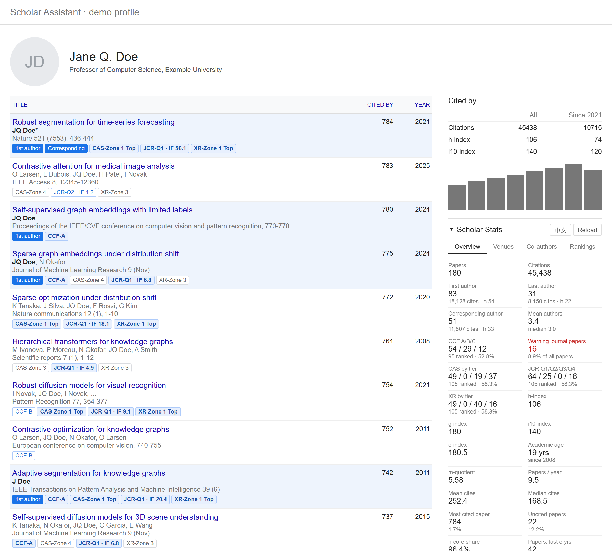
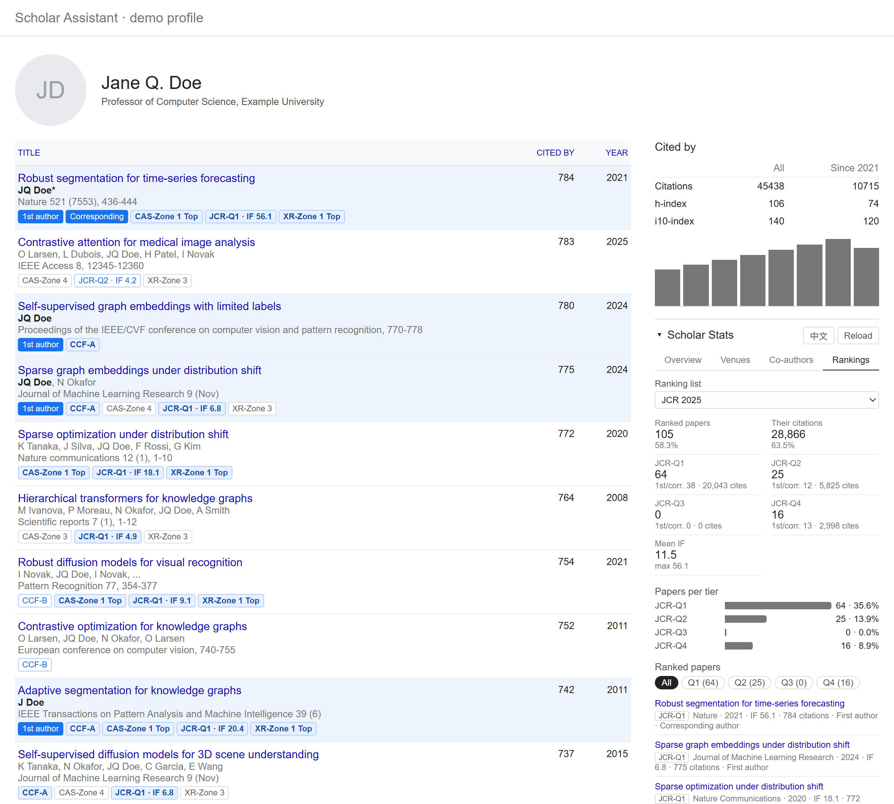

# Scholar Assistant: Google Scholar profile analytics (Chrome extension)

[中文](README.md) · **English**

A Chrome extension for **Google Scholar profile analysis**: h-index, g-index and citation statistics,
first-author and corresponding-author counts, co-author analysis, and **journal / conference rankings**
(CCF, JCR quartiles and impact factor, CAS 中科院分区, XR 新锐分区, journal early warning list) for every paper.

It adds a statistics section to the **Cited by** box on Google Scholar profile pages (`/citations?user=...`),
below Scholar's own citation table and chart, and marks first-author papers and venue rankings in the article list.
It loads every publication on the profile automatically (100 per request, ~1 s apart). Useful for evaluating
researchers, preparing a CV or tenure/job application, or checking where a scholar publishes.





*Screenshots use a fictional demo profile (`test/harness.html`); on Scholar the section appears in the same place.*

## Features

- **Overview**: papers and citations, then authorship — first / last / corresponding author counts with
  their citations and h-index (sole-authored papers count as first author; a name ending in `*`, e.g. `Z Xiao*`,
  marks the corresponding author) and mean/median team size — then one tile per ranking list, h / g / i10 / e-index,
  m-quotient, academic age, mean/median citations, uncited papers, h-core share, last-5-year output and citations,
  year-over-year citation growth. Charts: citations per year, papers per year, papers by citation count, byline
  position. The owner's byline name is auto-detected and can be corrected at the bottom of the tab.
- **Venues**: publication types (journal, conference, preprint, patent, …) and top venues with citations.
- **Co-authors**: distinct and repeat co-authors, co-authored share, top co-authors.
- **Rankings**: for each ranking list, papers per tier with their citations and first/corresponding-author
  counts, journal/conference split, list-specific extras (mean impact factor, Top / warning journals), and a list of
  matched papers filterable by tier or flag. Every list also gets a summary tile in Overview.

  | List | File | Tiers | Extras |
  |---|---|---|---|
  | CCF Recommended List 2026 (CCF 推荐目录) | `CCF2026-UTF8.csv` | A / B / C | journals and conferences |
  | International Journal Early Warning List 2025 (国际期刊预警名单) | `GJQKYJMD2025.csv` | warning reason | warning list, exact names only |
  | CAS Journal Ranking 2025 (中科院分区表) | `FQBJCR2025-UTF8.csv` | Zone 1–4 (大类分区) | Top, warning marks |
  | JCR 2025 | `JCR2025-UTF8.csv` | Q1–Q4 (best across categories) | impact factor |
  | XR Journal Ranking 2026 (新锐期刊分区) | `XR2026-UTF8.csv` | Zone 1–4 (大类新锐分区) | Top, warning marks |

- **Article list marks**: rows of Scholar's own article list are marked too. First-author and corresponding-author
  papers get a tinted background, a "1st author" / "Corresponding" badge and the scholar's name in bold, and each
  paper gets a badge per matching ranking list (e.g. `CCF-A`, `CAS-Zone 1 Top`, `JCR-Q1 · IF 9.1`; top tiers are
  emphasized, warnings are red). Rows added by "Show more" are marked as they appear. Each mark can be switched off
  in the Rankings tab ("Mark in the article list").
- **Chinese and English UI**: toggle in the section header; defaults to the browser language.

## Install

1. Open `chrome://extensions` and turn on **Developer mode**.
2. Click **Load unpacked** and pick this folder.
3. Open any Google Scholar profile, for example `https://scholar.google.com/citations?user=JicYPdAAAAAJ`.

## Data sources

The ranking data in `data/` (CCF, JCR, CAS 中科院分区表, XR 新锐期刊分区 and the international journal early warning
list) comes from **[ShowJCR](https://github.com/hitfyd/ShowJCR)** by hitfyd, which compiles it from the original
publishers (ccf.org.cn, fenqubiao.com, xr-scholar.com, ewl.fenqubiao.com and Clarivate JCR). Many thanks to the ShowJCR
project. ShowJCR is licensed under GPL-3.0; the rankings themselves belong to their respective publishers. To update a
list, take the newer CSV from ShowJCR and rebuild the index (see below).

## Ranking lists

Ranking lists live in `data/` and are declared in `data/rankings.json`. To add one (CORE, a school's own list, ...):

1. Put a UTF-8 CSV in `data/`, one row per venue, with a header row.
2. Add an entry to `lists` in `data/rankings.json`:

   ```json
   {
     "id": "core2023",
     "name": { "zh": "CORE 2023", "en": "CORE 2023" },
     "shortName": "CORE",
     "file": "CORE2023.csv",
     "columns": { "abbr": "Acronym", "name": "Title", "tier": "Rank", "type": "Type" },
     "typeValues": { "Journal": "journal", "Conference": "conference" },
     "tiers": [{ "value": "A*", "label": "A*" }, { "value": "A", "label": "A" }, { "value": "B", "label": "B" }],
     "aliases": { "Advances in Neural Information Processing Systems": "NeurIPS" }
   }
   ```

   - `name`, `shortName`, tier `label`s and flag `label`s may be a plain string or `{ "zh": "1区", "en": "Zone 1" }`;
     the UI shows the current language.
   - `columns` maps your CSV's header names. Only `name` is required; `abbr`, `tier`, `type` and `field` are optional.
   - `columns.tier` may also be a list of columns; the best tier across them is used (JCR quartiles per category).
   - `tierPattern` (optional) is a regex whose first group is the tier, e.g. `"^\\s*(\\d)"` (as written in JSON) turns `4 [625/778]` into `4`.
   - `tiers` (optional) lists the tier values to count, in display order; rows with other values are ignored.
     Without it, tiers are the distinct values of the `tier` column in file order (or one tier if there is no `tier` column).
   - `metric` (optional), e.g. `{ "column": "IF(2025)", "label": "IF", "decimals": 1 }`, is shown per paper and as a mean.
   - `flags` (optional) mark venues, e.g. `{ "column": "Top", "equals": "是", "label": "Top" }`; use `contains` or
     `notEmpty: true` instead of `equals` as needed, and `warn: true` to show the flag in red.
   - `defaultType` (optional) sets `journal` or `conference` for every row when there is no `type` column.
   - `kind: "warning"` (optional) marks a list of venues to avoid, such as the international journal early warning list:
     it is shown in red with warning wording, and it matches exact names only (`strict: true`), because a near-miss
     would flag the wrong journal.
   - `aliases` maps venue names as Scholar prints them to an abbreviation or full name in the list,
     for venues whose Scholar name differs a lot from the official one.
3. Rebuild the index, then reload the extension:

   ```bash
   node tools/build-index.js
   ```

   With more than one list, the Rankings tab shows a selector; the choice is remembered.

### The index

The extension never reads the CSVs. `tools/build-index.js` merges all lists into `index/`: one record per
distinct venue name holding its tier, metric and flags in every list, split into 64 small shard files by a hash
of the venue key (`index/r/`), plus word postings for fuzzy matching (`index/t/`), abbreviations (`abbr.json`)
and list descriptions (`meta.json`). At run time the extension computes the keys and words of the scholar's own
venue strings and fetches only the shards they hash to — typically a few dozen files of under 100 KB each instead
of ~12 MB of CSV. `index/` is generated: commit it after rebuilding, since Chrome loads the folder as-is.

Venue matching (`src/rankings.js`) tries, in order: a parenthesised abbreviation such as "(TOG)", the exact
normalized full name, a standalone abbreviation of 4+ letters (e.g. "CVPR 2020"), then a word-overlap match that
also handles names Scholar truncated with "…". Workshops, Findings, companions and newsletters are never counted,
and a venue that calls itself a conference is never credited to a journal of the same name (ICML vs *Machine Learning*).
Matching logic lives in `src/rankings.js` and is shared by the build script (Node) and the extension.

## Limitations

- Scholar truncates long author lists with "...". Those papers are left out of team-size stats, and
  last authorship can't be determined for them.
- Venue names are normalized from Scholar's raw strings and publication types are keyword heuristics.
- Co-authors are merged by first initial + surname, so namesakes can merge.
- Ranking matches are heuristic: a heavily truncated or unusual venue string can be missed, and a book
  chapter titled like a journal can be counted as that journal.
- If Scholar shows a CAPTCHA partway through, the panel says so and shows stats for the papers loaded so far.

## Development

`test/harness.html` renders the extension on a fictional demo profile with no network access.
Serve the repo root (for example `python -m http.server 8766`) and open `/test/harness.html`.
URL parameters `lang=zh|en`, `tab=<index>` and `list=<ranking list id>` preset the view; the README screenshots
are taken with headless Chrome/Edge, e.g.
`msedge --headless=new --force-device-scale-factor=2 --window-size=1200,1080 --virtual-time-budget=10000 --screenshot=out.png "http://localhost:8766/test/harness.html?lang=en&tab=3&list=jcr2025"`.
`src/stats.js` and `src/rankings.js` have no DOM dependencies and can be `require`d from Node.
