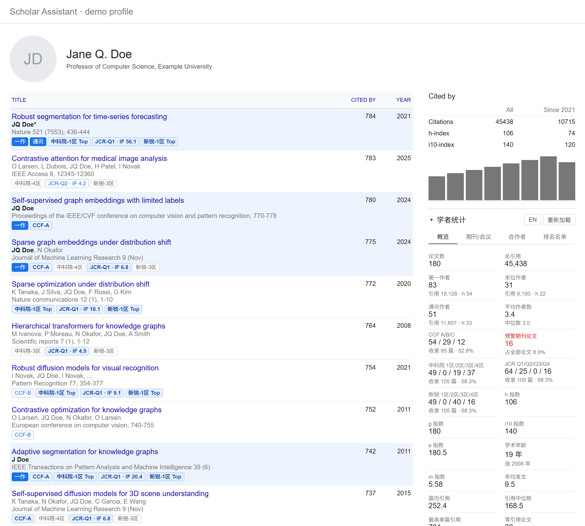
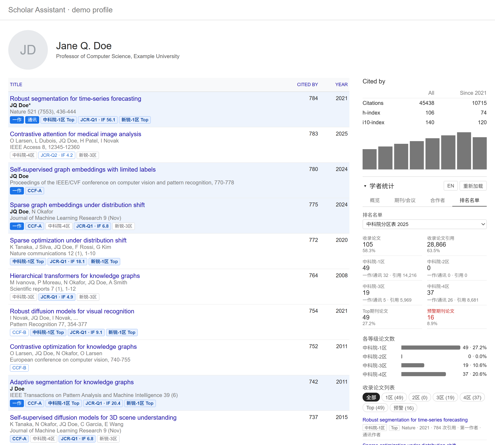

# Scholar Assistant：谷歌学术学者主页统计插件（Chrome）

**中文** · [English](README.en.md)

一个 **Google Scholar（谷歌学术）学者主页分析**的 Chrome 插件：统计 h 指数、g 指数、引用数据，
一作/通讯作者论文数和合作者，并为每篇论文标注**期刊/会议分区与等级**——CCF 推荐目录、JCR 分区与影响因子、
中科院分区表、新锐期刊分区、国际期刊预警名单。适用于评估学者、准备简历、职称/求职材料，或快速了解一位学者的发表情况。

在 Google Scholar 学者主页（`/citations?user=...`）右侧 **Cited by** 框中、Scholar 自带的引用表和柱状图下方，
加入一个“学者统计”区域；同时在左侧文章列表中标注一作/通讯论文和期刊会议的排名等级。
打开主页后会自动加载该学者的全部论文（每次 100 篇，间隔约 1 秒）。在 Scholar 搜索结果中，每篇论文下方也会显示其期刊/会议排名。





*截图使用虚构的演示主页（`test/harness.html`）；在 Scholar 上统计区域出现在相同位置。*

## 功能

- **概览**：论文数、总引用；署名统计——第一作者、末位作者、通讯作者的论文数及其引用和 h 指数
  （独立作者的论文计为第一作者；作者名后带 `*` 的视为通讯作者，如 `Z Xiao*`），平均/中位作者数；
  每个排名名单的汇总；h / g / i10 / e 指数、m 指数、学术年龄、篇均/中位引用、零引用论文、h 核心引用占比、
  近 5 年发文与引用、引用同比增长。图表：每年获得引用、每年发表论文、论文引用次数分布、署名位置分布。
  学者本人的署名会自动识别，识别不准时可在概览底部修改。
- **期刊/会议**：发表类型（期刊、会议、预印本、专利等）分布，以及主要发表源的篇数和引用。
- **合作者**：合作者人数、多次合作者、合作论文占比、主要合作者。
- **排名名单**：每个名单各等级的论文数、引用、一作/通讯篇数，期刊/会议构成，名单特有信息
  （平均影响因子、Top 期刊、预警期刊），以及可按等级或标记筛选的收录论文列表。每个名单在概览中也有一项汇总。

  | 名单 | 文件 | 等级 | 额外信息 |
  |---|---|---|---|
  | CCF 推荐目录 2026 | `CCF2026-UTF8.csv` | A / B / C | 期刊和会议 |
  | 国际期刊预警名单 2025 | `GJQKYJMD2025.csv` | 预警原因 | 预警名单，仅精确匹配名称 |
  | 中科院分区表 2025 | `FQBJCR2025-UTF8.csv` | 1–4 区（大类分区） | Top、预警标注 |
  | JCR 2025 | `JCR2025-UTF8.csv` | Q1–Q4（取各学科中最好的分区） | 影响因子 |
  | 新锐期刊分区 2026 | `XR2026-UTF8.csv` | 1–4 区（大类新锐分区） | Top、预警标记 |

- **左侧文章列表标注**：一作和通讯论文整行浅蓝底色，显示“一作”/“通讯”标签，学者本人姓名加粗；
  每篇论文按命中的名单显示等级标签（如 `CCF-A`、`中科院-1区 Top`、`JCR-Q1 · IF 9.1`；最高等级加粗，预警为红色）。
  点击“Show more”新加载的论文也会自动标注。
- **搜索结果排名**：在 Google Scholar 搜索结果页（`/scholar?q=...`），每条结果的作者/发表源一行下方显示该期刊/会议在各名单中的等级。
  Scholar 截断得过短、无法确定的名称（如 “Proceedings of the …”）不显示，以免误标。
- **设置弹窗**：点击浏览器工具栏中的插件图标，可启用/关闭各排名名单（关闭后不出现在统计、文章列表和搜索结果中）、
  开关一作/通讯标注和搜索结果排名、选择界面语言。设置自动保存，并立即应用到已打开的 Scholar 页面。
- **中英文界面**：在设置弹窗或统计区域标题栏切换，默认跟随浏览器语言。

## 安装

1. 打开 `chrome://extensions`，开启右上角的**开发者模式**。
2. 点击**加载已解压的扩展程序**，选择本文件夹。
3. 打开任意 Google Scholar 学者主页，例如 `https://scholar.google.com/citations?user=JicYPdAAAAAJ`。

## 数据来源

`data/` 中的排名数据（CCF、JCR、中科院分区表、新锐期刊分区表和国际期刊预警名单）来自
**[ShowJCR](https://github.com/hitfyd/ShowJCR)**（作者 hitfyd），该项目整理自各数据的原始发布方
（ccf.org.cn、fenqubiao.com、xr-scholar.com、ewl.fenqubiao.com 以及 Clarivate JCR）。感谢 ShowJCR 项目。
ShowJCR 采用 GPL-3.0 许可证；各排名数据的权利归各自发布方所有。更新名单时，从 ShowJCR 获取新版 CSV 并重新生成索引（见下文）。

## 排名名单

排名名单放在 `data/` 中，并在 `data/rankings.json` 中登记。新增一个名单（如 CORE、学校自定名单等）：

1. 把 UTF-8 编码、带表头、每行一个期刊/会议的 CSV 放进 `data/`。
2. 在 `data/rankings.json` 的 `lists` 中加入一项：

   ```json
   {
     "id": "core2023",
     "name": { "zh": "CORE 2023", "en": "CORE 2023" },
     "shortName": "CORE",
     "file": "CORE2023.csv",
     "columns": { "abbr": "Acronym", "name": "Title", "tier": "Rank", "type": "Type" },
     "typeValues": { "Journal": "journal", "Conference": "conference" },
     "tiers": [{ "value": "A*", "label": "A*" }, { "value": "A", "label": "A" }, { "value": "B", "label": "B" }],
     "aliases": { "Advances in Neural Information Processing Systems": "NeurIPS" }
   }
   ```

   - `name`、`shortName`、等级和标记的 `label` 可以是普通字符串，也可以是 `{ "zh": "1区", "en": "Zone 1" }`，界面按当前语言显示。
   - `columns` 指定 CSV 的列名。只有 `name` 必填；`abbr`、`tier`、`type`、`field` 可选。
   - `columns.tier` 也可以是多个列，取其中最好的等级（如 JCR 各学科分区）。
   - `tierPattern`（可选）是正则表达式，取第一个分组作为等级，例如 JSON 中写 `"^\\s*(\\d)"` 可把 `4 [625/778]` 变成 `4`。
   - `tiers`（可选）按显示顺序列出要统计的等级，其他取值的行会被忽略。
     不写时，等级取 `tier` 列中出现的各个取值（按文件顺序）；没有 `tier` 列时只有一个等级。
   - `metric`（可选），如 `{ "column": "IF(2025)", "label": "IF", "decimals": 1 }`，在每篇论文旁显示，并计算平均值。
   - `flags`（可选）用于标记期刊，如 `{ "column": "Top", "equals": "是", "label": "Top" }`；也可用 `contains` 或
     `notEmpty: true` 代替 `equals`，`warn: true` 表示以红色显示。
   - `defaultType`（可选）在没有 `type` 列时，为所有行指定 `journal` 或 `conference`。
   - `kind: "warning"`（可选）表示这是需要避开的名单（如国际期刊预警名单）：以红色和“预警”措辞显示，
     并且只做名称精确匹配（`strict: true`），避免把名称相近的期刊误标为预警。
   - `aliases` 把 Scholar 上显示的期刊/会议名称映射到名单中的缩写或全称，用于两者差异较大的情况。
3. 重新生成索引，然后在 `chrome://extensions` 中刷新插件：

   ```bash
   node tools/build-index.js
   ```

   有多个名单时，“排名名单”页顶部可以切换，选择会被记住；在设置弹窗中可以启用或关闭各个名单。

### 索引

插件运行时不读取 CSV。`tools/build-index.js` 把所有名单合并到 `index/`：每个不同的期刊/会议名称一条记录，
包含它在各名单中的等级、指标和标记；记录按名称键的哈希分成 64 个小文件（`index/r/`），另有用于模糊匹配的词索引
（`index/t/`）、缩写表（`abbr.json`）和名单说明（`meta.json`）。运行时插件只计算该学者自己论文的发表源对应的键和词，
并只读取它们所在的分片——通常是几十个不超过 100 KB 的文件，而不是约 12 MB 的 CSV。
`index/` 是生成文件，重新生成后需要一起提交，因为 Chrome 直接加载整个文件夹。

发表源匹配（`src/rankings.js`）依次尝试：括号中的缩写（如 "(TOG)"）、规范化后的完整名称、4 个字母以上的独立缩写
（如 "CVPR 2020"），最后是词重叠匹配（也能处理被 Scholar 截断成 “…” 的名称）。Workshop、Findings、Companion、
Newsletter 等附属出版物不计入；自称会议的发表源不会被算作同名期刊（如 ICML 与期刊 *Machine Learning*）。
匹配逻辑在 `src/rankings.js` 中，构建脚本（Node）和插件共用。

## 局限

- Scholar 会把较长的作者列表截断为 “...”，这些论文不计入平均作者数，也无法判断末位作者。
- 发表源名称由 Scholar 的原始字符串规范化得到，发表类型为关键词启发式判断。
- 合作者按“名首字母 + 姓”合并，同名者可能被合并。
- 排名匹配是启发式的：被严重截断或写法特殊的发表源可能匹配不上，与某期刊同名的书籍章节可能被算作该期刊。
- 如果加载中途 Scholar 弹出人机验证，统计区域会提示，并先显示已加载论文的统计。

## 开发

`test/harness.html` 在虚构的演示主页上运行插件，不需要联网；`test/search.html` 是模拟的搜索结果页，
`test/popup.html` 加载真实的设置弹窗。它们共用 `test/chrome-stub.js`（用 localStorage 模拟 `chrome.storage`），
所以在一个标签页的弹窗里修改设置，会立即反映到另一个标签页中。在仓库根目录启动静态服务器
（如 `python -m http.server 8766`），然后打开对应页面。
`test/harness.html` 的 URL 参数 `lang=zh|en`、`tab=<序号>`、`list=<名单 id>`、`scroll=<像素>` 可预设显示内容；README 中的截图用无头 Chrome/Edge 生成，例如
`msedge --headless=new --force-device-scale-factor=2 --window-size=1200,1080 --virtual-time-budget=10000 --screenshot=out.png "http://localhost:8766/test/harness.html?lang=zh&tab=3&list=cas2025"`。
`src/stats.js` 和 `src/rankings.js` 不依赖 DOM，可在 Node 中 `require`。
